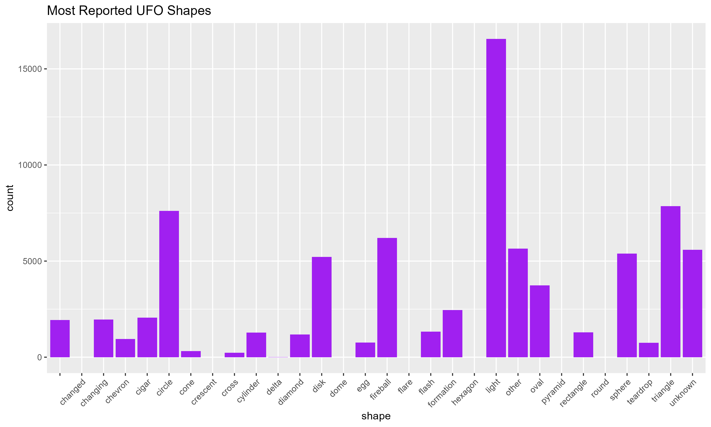
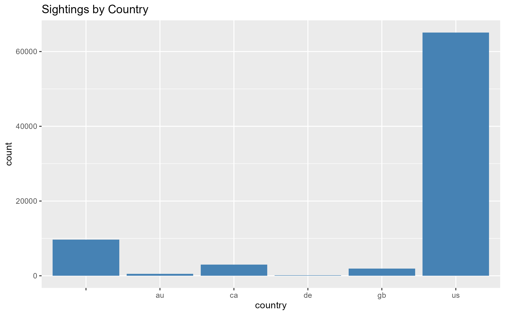
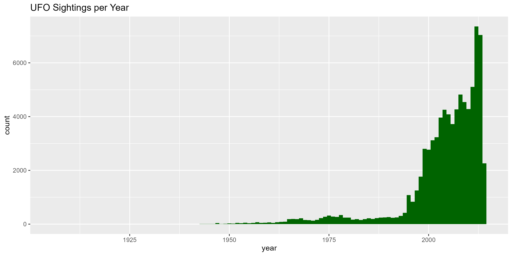
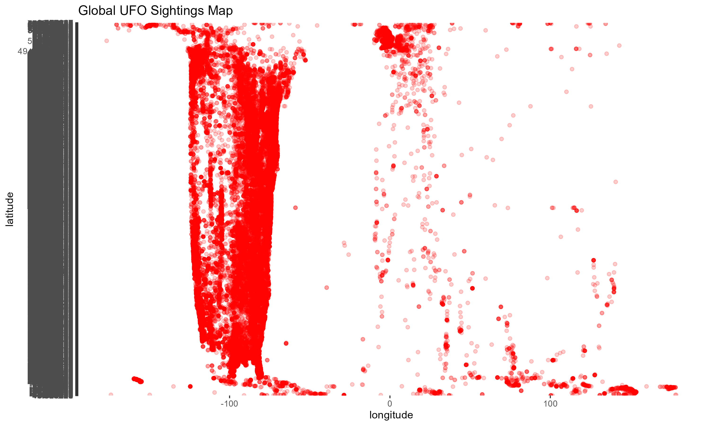
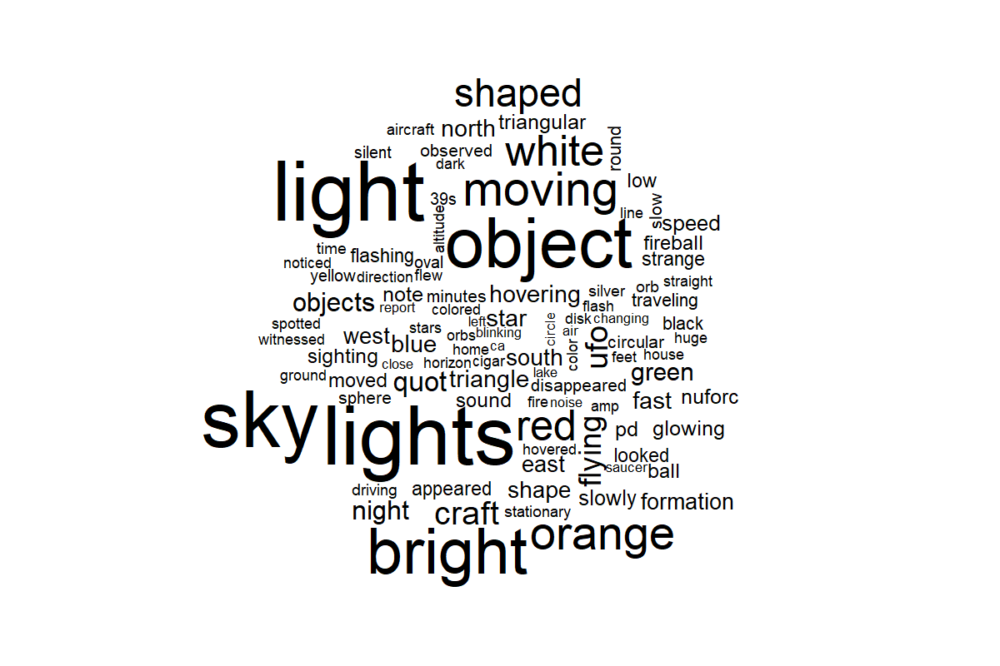

# UFO Sightings: Exploratory Data Analysis (R)

Exploratory data analysis of a global dataset of reported UFO sightings in **R**. The project cleans the raw records, then uses multivariate wrangling and visualization to find patterns: which shapes are reported most, where sightings happen, and how reports changed over time.

## What's inside

- **Data cleaning:** the raw `data/raw/ufo.csv` is cleaned into `data/cleaned/ufo_clean.csv`
- **Visual analysis** with `ggplot2`:

| Most reported shapes | Sightings by country |
|---|---|
|  |  |

| Sightings over the years | World map of sightings |
|---|---|
|  |  |

**Word cloud of sighting descriptions**

## Tools

R · ggplot2 · data wrangling · EDA · data visualization

## How to run

Open `ufo-eda-r-project.Rproj` in RStudio and run the analysis. The figures are saved to `outputs/eda_figures/`.

---
Author: **Mays Owais** · [Portfolio](https://maysowais.github.io/Mays-s-Portfolio/) · [LinkedIn](https://www.linkedin.com/in/mays-owais-718bb725a)
